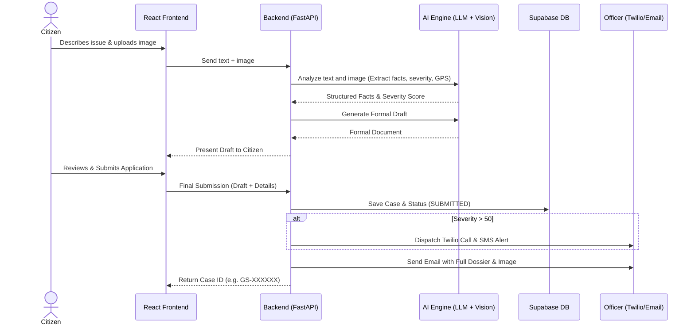
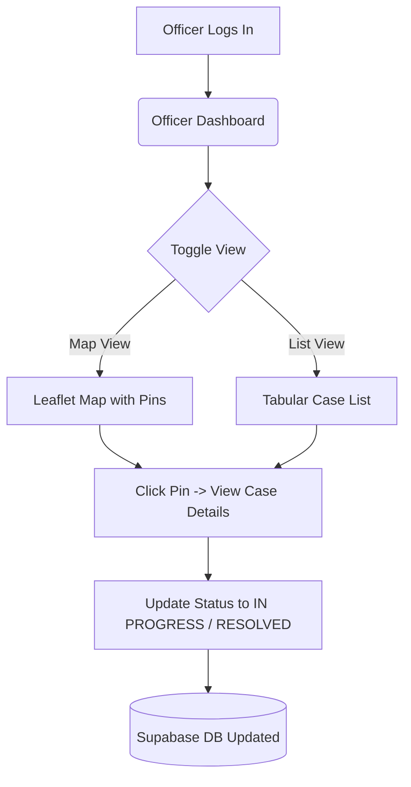

# 🏛️ CivicScribe

<div align="center">
  <h3>A Smart, AI-Powered Civic Grievance and RTI Drafting Platform</h3>
  <p>Bridging the gap between citizens and authorities with intelligent drafting, multi-modal evidence analysis, and automated workflows.</p>
</div>

---

## 📖 Overview

CivicScribe is an end-to-end platform that enables citizens to seamlessly report civic issues or file Right to Information (RTI) requests. It uses advanced AI (Large Language Models and Vision Models) to translate a citizen's raw complaints and uploaded images into formally structured, legally sound grievance documents.

The system features two main portals:
1. **Citizen Portal:** A step-by-step wizard where citizens can describe their issue, upload photo evidence, get an AI-generated formal draft, review it, and submit.
2. **Officer Portal:** A dedicated dashboard for civic authorities to view grievances on a map, analyze AI-extracted severity scores, manage case statuses, and receive instant automated Twilio calls/SMS alerts for high-severity issues.

---

## ✨ Key Features

- **🤖 AI-Powered Drafting:** Automatically converts casual language into formal civic complaints or RTI applications.
- **📸 Multi-modal Evidence Analysis:** Analyzes uploaded photos to extract exact GPS coordinates and assess the "severity" of the issue using AI vision models.
- **📍 Geospatial Dashboard:** Officers can view all complaints mapped out via an interactive leaflet map or in a list view.
- **🔔 Automated Escalation:** Integrates with **Twilio** and **SMTP** to automatically call, text, and email officers when a high-severity (Score > 50) complaint is filed.
- **🔄 Live Status Tracking:** Citizens can track the real-time resolution status of their cases using a unique case ID.

---

## 🏗️ System Architecture & Flow



### Dashboard View Flow


---

## 🛠️ Technology Stack

**Frontend:**
- React (Vite)
- Tailwind CSS
- Lucide React (Icons)
- React Router (Navigation)
- React Leaflet (Mapping)

**Backend:**
- Python (FastAPI)
- Uvicorn
- Supabase (PostgreSQL + Auth + Storage)
- Groq / OpenAI (LLM processing)
- Twilio API (Voice & SMS)
- SMTP (Email Notifications)

---

## 🚀 Local Setup & Installation

### 1. Clone the repository
```bash
git clone https://github.com/Santhanamsk02/CivicScribe.git
cd CivicScribe
```

### 2. Backend Setup
```bash
cd backend
python -m venv venv
venv\Scripts\activate  # On Windows
pip install -r requirements.txt
```

**Environment Variables (`backend/.env`):**
Create a `.env` file in the `backend` directory and add the following:
```env
SUPABASE_URL=your_supabase_url
SUPABASE_KEY=your_supabase_key

GROQ_API_KEY=your_groq_key

# Twilio integration (Optional for SMS/Calls)
TWILIO_ACCOUNT_SID=your_sid
TWILIO_AUTH_TOKEN=your_token
TWILIO_PHONE_NUMBER=your_twilio_number

# SMTP integration (Optional for Emails)
SMTP_SERVER=smtp.gmail.com
SMTP_PORT=587
SMTP_USERNAME=your_email@gmail.com
SMTP_PASSWORD=your_app_password
```

**Run Backend:**
```bash
uvicorn main:app --reload
```

### 3. Frontend Setup
```bash
cd frontend
npm install
```

**Environment Variables (`frontend/.env`):**
```env
VITE_SUPABASE_URL=your_supabase_url
VITE_SUPABASE_ANON_KEY=your_supabase_key
```

**Run Frontend:**
```bash
npm run dev
```

The frontend will be available at `http://localhost:5173` and the backend at `http://127.0.0.1:8000`.

---

## 👮 Demo Access
- **Citizen Portal:** Access the homepage directly to start filing.
- **Officer Portal:** Click "Officer Access" in the footer. Use the "Demo Login" feature to bypass authentication for local testing.

---
*Built to empower citizens and streamline civic governance.*
